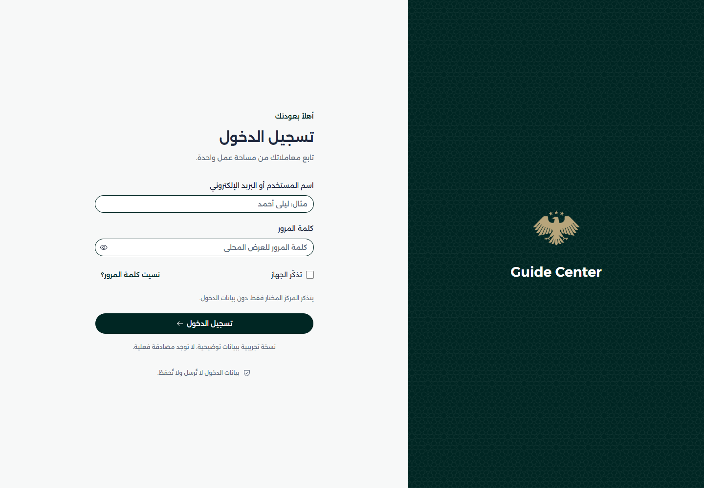

# 02 · Create and brand a center

[README](../README.md) · Previous: [Workspace](01-workspace.md) · Next: [Generate code](03-generate-code.md)

## Create the application

From the repository root, run:

```sh
npm run center:new -- guide-center
```

With the technical ID supplied, the first question is:

```text
Does this center have a defined visual identity? (y/n):
```

Choose `n` for primary `#002623`, secondary `#988561`, and the default artwork as logo and favicon. The next question is `Center name:`; enter `Guide Center`.

Choose `y` if you have brand colors. The questions then come in this order:

```text
Primary color (HEX, e.g. #397b73):
Secondary color (HEX, e.g. #baa97d):
Center name:
```

The technical ID names folders, commands, and URL prefixes. Start with a lowercase Latin letter; use lowercase letters, digits, and hyphens, up to 48 characters. The display name is what people see. If you supply a quoted display name instead of an ID, the generator asks `Center ID (e.g. new-center):` after the identity/color questions and uses the supplied display name.


*Earlier capture from 26 October 2026: real default-identity output rendered as a transcript. These original prompts were not rerun for this rewrite.*

## Review the result

The generator creates `apps/guide-center`, registers Angular/npm/Turbo commands, and updates the lockfile and workspace links with `npm install --ignore-scripts`. If installation fails, the files remain; rerun that install command from the root.

| Generated path inside the app | What it owns |
| --- | --- |
| `src/config/center.ts` | Display name and image URLs |
| `src/config/module.ts` | Composition and the initial memory adapter |
| `src/config/services.ts`, `reports.ts` | Illustrative services, data settings, and reports |
| `src/routes.ts`, `src/navigation.ts` | Extra pages / menu links |
| `src/app.config.ts`, `src/environments/` | API providers and test/production values |
| `src/brand.css`, `brand.json` | Applied theme / recorded brand inputs |
| `public/brands/guide-center/` | Copied logo and stars pattern |
| `src/main.ts`, `styles.css`, `index.html` | Bootstrap, styles, browser document |

At the root, review `angular.json`, `package.json`, `turbo.json`, `package-lock.json`, and `tests/e2e/guide-center.generated.spec.ts`. App manifests include deletion metadata. The sample catalog, fees, accounts, and records need approved definitions later.


*Earlier listing, captured after adding a page and separate favicon. The `pages` folder and `favicon.webp` were tutorial additions, not initial generator output.*

## Run it

From the root:

```sh
npm run dev:guide-center
```

Open the printed URL. The earlier capture used `http://localhost:5207`; use your terminal's value. Ports are chosen from configured assignments, not checked against unrelated programs running locally.



*Earlier real desktop capture. Leave demo credentials empty and click Sign in; this is not production authentication.*


*Earlier real dashboard capture. The shared layout uses this app's identity.*

## Update the identity

Change the name and image URLs in `src/config/center.ts`. Keep the initial title and icon in `src/index.html` aligned; bootstrap sets them from the profile when the app starts.

There are three asset locations:

```text
Tooling source: assets/branding/default-center/id.webp
App file:      apps/guide-center/public/brands/guide-center/logo.webp
Browser URL:   /assets/brands/guide-center/logo.webp
```

The Angular assets mapping adds `/assets`. Root `assets/` is not served automatically. Changing a source image does not update existing app copies.

Copy your approved logo into the app's brand folder, then update `logo` and `source` in the profile. For a separate favicon, add its file and update both the profile's `favicon` and `<link rel="icon">` in `index.html`. Keep the extension in the URL. Without a supplied logo, the custom-identity path creates a temporary geometric marker. New centers receive a copy of the stars pattern.

`brand.json` records inputs; editing it alone does not regenerate CSS. Applied values live in `src/brand.css`. The primary anchors `brand-950`, the secondary anchors `highlight-500`, and action colors may be adjusted for contrast. Use existing semantic tokens; shared status colors keep their meanings.

## Optional flags

From the root, before creating the ID, preview custom colors without writing files:

```sh
npm run center:new -- guide-center --name "Guide Center" --visual-identity y --primary "#397b73" --secondary "#baa97d" --dry-run
```

| Flag | Use it for |
| --- | --- |
| `--visual-identity n` | Default identity without color questions; cannot combine with custom colors/logo |
| `--logo ./my-logo.png` | Copy your own SVG, PNG, JPEG, WebP, or ICO unchanged, with custom identity |
| `--id guide-center`, `--name "Guide Center"` | Supply identifiers without questions |
| `--skip-install` | Write files only; run `npm install --ignore-scripts` afterward |
| `--dry-run` | Preview without files/install; an existing ID is still rejected |
| `--help` | Show supported options |

Use `npm.cmd` in PowerShell if npm.ps1 does not forward flags correctly. Deletion and production verification are in [chapter 06](06-build-and-check.md).

Now that the center is running, generate the code you will put in it.

[README](../README.md) · Previous: [Workspace](01-workspace.md) · Next: [Generate code](03-generate-code.md)
