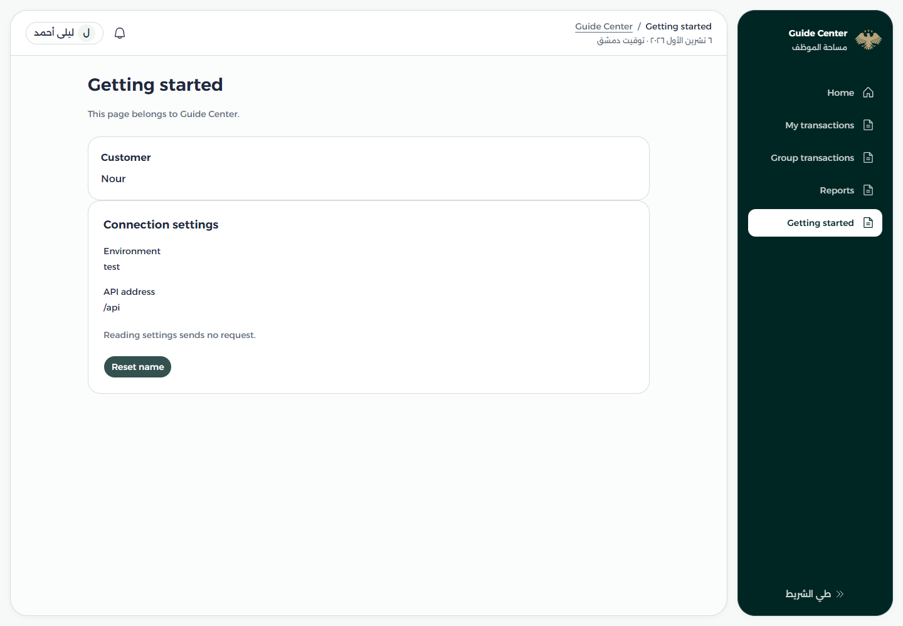
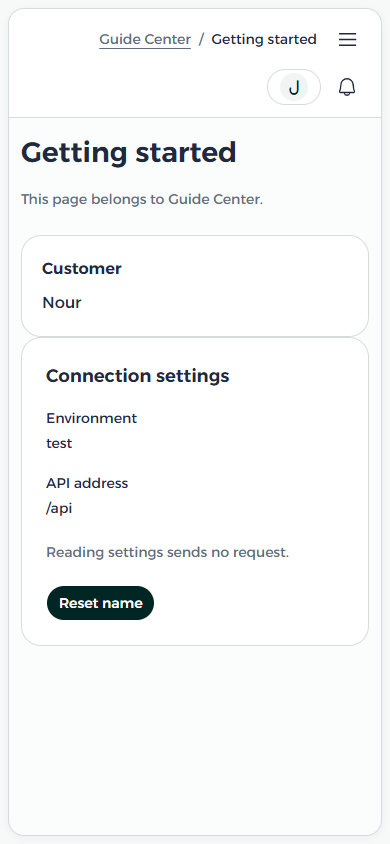
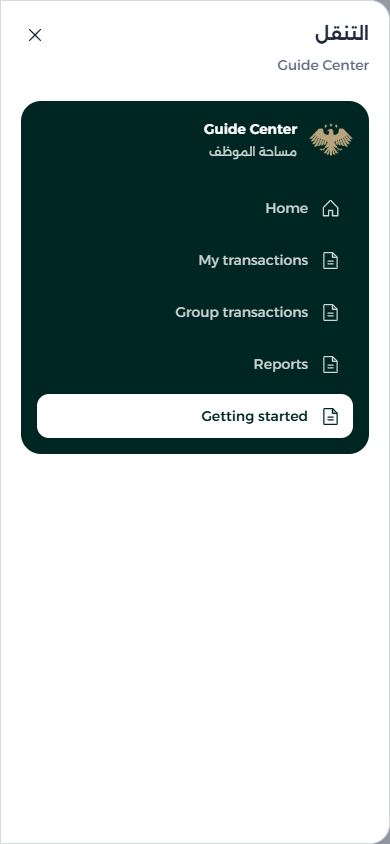

# 04 · Put the page in the workspace

[README](../README.md) · Previous: [Generate code](03-generate-code.md) · Next: [Data and API](05-data-and-api.md)

The previous chapter created a card, draft service, pipe, directive, and parent page. Now connect them and open the page through the center's menu.

## Finish the page

Replace `apps/guide-center/src/pages/getting-started/getting-started.ts` with:

```ts
import { Component, inject } from '@angular/core';
import { HlmButton } from '@spartan-ng/helm/button';
import { API_CONFIG } from '@workspace/data-access';
import { CustomerCard } from '../../components/customer-card/customer-card';
import { BusyDirective } from '../../directives/busy.directive';
import { environment } from '../../environments/environment';
import { DisplayNamePipe } from '../../pipes/display-name.pipe';
import { CustomerDraftService } from '../../services/customer-draft.service';

@Component({
  selector: 'app-getting-started',
  imports: [CustomerCard, BusyDirective, DisplayNamePipe, HlmButton],
  templateUrl: './getting-started.html',
})
export class GettingStarted {
  readonly draft = inject(CustomerDraftService);
  readonly api = inject(API_CONFIG);
  readonly environmentName = environment.name;
}
```

Replace its `getting-started.html` with:

```html
<section dir="ltr" class="mx-auto max-w-4xl space-y-6" [appBusy]="draft.saving()">
  <header>
    <h1 class="text-page-title font-semibold">Getting started</h1>
    <p class="mt-3 text-sm text-muted-foreground">This page belongs to Guide Center.</p>
  </header>
  <app-customer-card [name]="draft.name() | displayName" />
  <article class="rounded-panel border bg-card p-6">
    <h2 class="text-lg font-semibold">Connection settings</h2>
    <dl class="mt-4 space-y-4 text-sm">
      <div><dt>Environment</dt><dd>{{ environmentName }}</dd></div>
      <div><dt>API address</dt><dd class="break-all">{{ api.baseUrl }}</dd></div>
    </dl>
    <p class="my-5 text-sm text-muted-foreground">Reading settings sends no request.</p>
    <button hlmBtn type="button" (click)="draft.name.set('Nour')">Reset name</button>
  </article>
</section>
```

The service is injected. The card, pipe, directive, and button are in `imports` because the template uses them. The page can import its own environment; shared code receives configuration through DI, as [chapter 05](05-data-and-api.md) demonstrates.

## Give it a URL

In an existing application, retain its routes and append the new entry to `extensions`. For the disposable tutorial application only, its empty `apps/guide-center/src/routes.ts` can be replaced completely with:

```ts
import type { CenterPages, CenterRoute } from '@workspace/core';
import { GettingStarted } from './pages/getting-started/getting-started';

export const extensions: CenterRoute[] = [
  { path: 'getting-started', component: GettingStarted },
];
export const pages: CenterPages = {};
```

Open `/centers/guide-center/getting-started` on the app's development origin. Paths in the registration are relative: no leading slash or center prefix. Keep the dev server running and wait for its rebuild before checking the new route.

## Put it in the menu

Routes select pages for URLs. Navigation controls visible links and groups. Removing a link does not remove its route or restrict access.

For the disposable tutorial application only, replace `apps/guide-center/src/navigation.ts` with this complete menu. In a real app, keep its entries and add or move the new link in the existing tree.

```ts
import type { CenterNavItem } from '@workspace/core';

export const navigation: readonly CenterNavItem[] = [
  { kind: 'link', id: 'home', label: 'Home', path: '', icon: 'phosphorHouse' },
  { kind: 'link', id: 'personal', label: 'My transactions', path: 'inbox/personal' },
  { kind: 'link', id: 'group', label: 'Group transactions', path: 'inbox/group' },
  { kind: 'link', id: 'reports', label: 'Reports', path: 'reports' },
  { kind: 'link', id: 'getting-started', label: 'Getting started', path: 'getting-started' },
];
```

The generated `config/module.ts` already passes `routes: extensions`, `pages`, and `navigation` into `defineCenter`. No second router or bootstrap registration is needed.



*New capture for these chapters: the page above with test settings and the initial `/api` address. The shell remains Arabic/RTL; the tutorial page's English content has its own direction.*



*New mobile capture: the API value and customer card stay within the document width.*



*New mobile capture. Open the navigation sheet and select the same link to return to the page.*

## Group links and choose icons

To group the page instead of keeping its flat link, replace the `getting-started` menu entry above with:

```ts
{
  kind: 'group',
  id: 'guide',
  label: 'Center guide',
  icon: 'phosphorInfo',
  children: [
    { kind: 'link', id: 'getting-started', label: 'Getting started', path: 'getting-started' },
  ],
}
```

The group does not need a route and does not change the child's URL. Without an explicit icon, top-level links use `phosphorFileText`, groups use `phosphorTreeStructure`, and child links use `phosphorArrowLeft`. Custom names must be registered in `packages/ui/src/components/icon/icon.ts`. Route icons and menu icons are independent.

Expanded sidebars/mobile sheets show disclosures; navbar and collapsed-sidebar menus use dropdowns. IDs must be unique across the tree, groups cannot be empty, and paths stay relative to the center. `exact: true` restricts active matching to that destination; home matches exactly by default. Inbox links may use `badge: 'personal'` or `'group'`.

## Default navigation and shared pages

Generated `navigation` starts as `undefined`. This uses the default product menu and appends extension routes with a `label`. For that alternative, keep navigation undefined and give the route `label: 'Getting started'`. An explicit array defines the whole menu; `[]` shows none. The screenshots use the explicit array above.

To reuse a shared page, export it from `packages/core/src/index.ts`, import it from `@workspace/core` in the application's `routes.ts`, and append its component to `extensions`. The shared `ApiExamplesPage` is an existing example; it requires a matching JSONPlaceholder API address and is separate from transaction data.

To replace a built-in page with a compatible component, keep the existing `pages` entries and assign `pages.dashboard = GettingStarted;` after its declaration. This keeps the dashboard URL rather than creating a second destination. Other supported keys are `login`, `inbox`, `transaction`, `reports`, and `designSystem`; replacement components must satisfy the feature's expected behavior. This tutorial does not replace a built-in page.

## Extension limits

`CenterRoute` forwards `path` and `component` to the router; `label` and `icon` support default navigation. It does not forward arbitrary Angular route guards, lazy loaders, child routes, or providers. The shared router still supplies `/login`, `/centers/<id>`, and product destinations. Completely independent route trees need a deliberate contract change.

Other composition hooks include capabilities, section/action/form registry additions and overrides, and inbox customization. Registry conflicts reject; an override replaces a known entry. Inspect the typed contracts in `packages/core/src/module.ts` when you need these, rather than copying shared pages for minor differences.

[README](../README.md) · Previous: [Generate code](03-generate-code.md) · Next: [Data and API](05-data-and-api.md)
