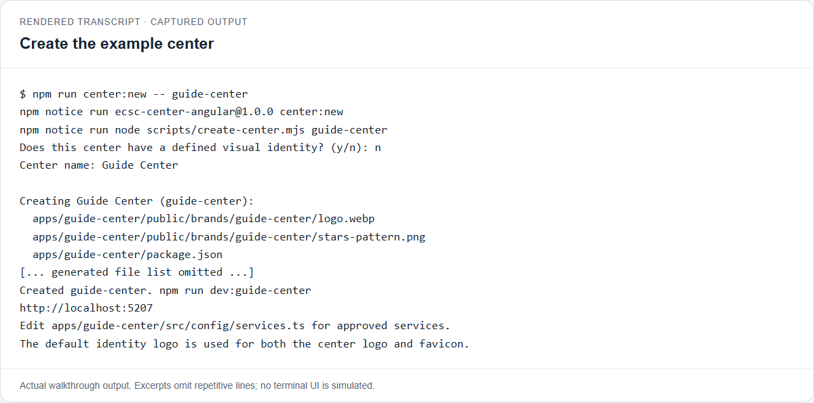
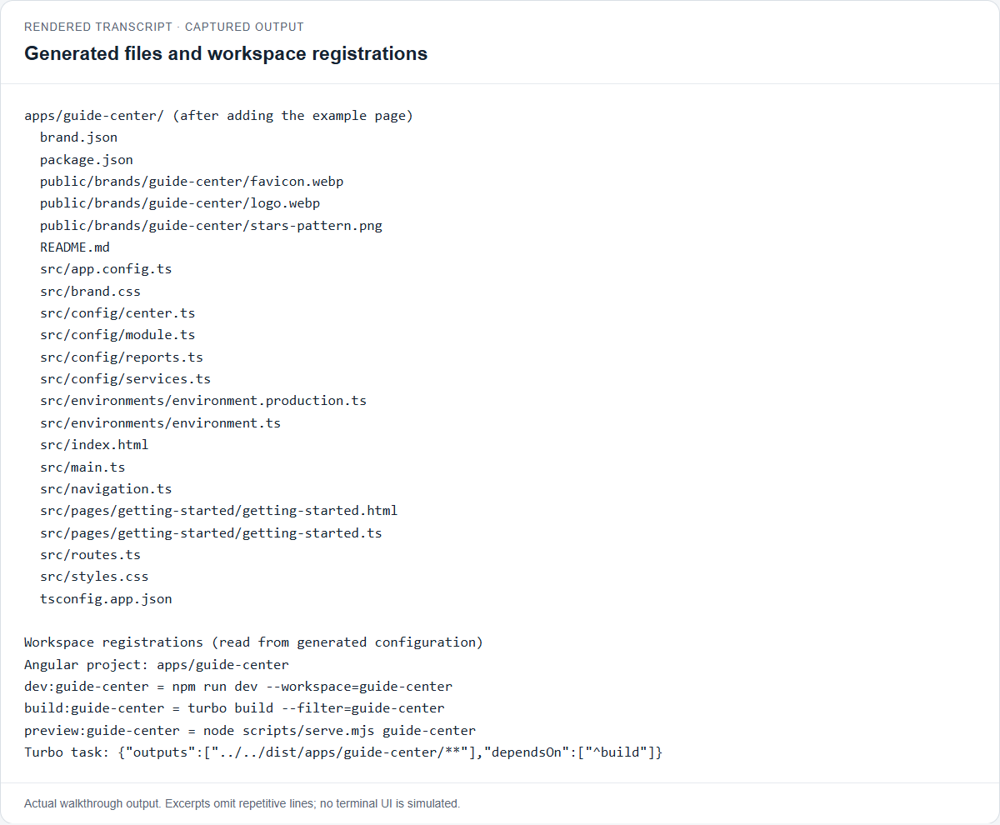
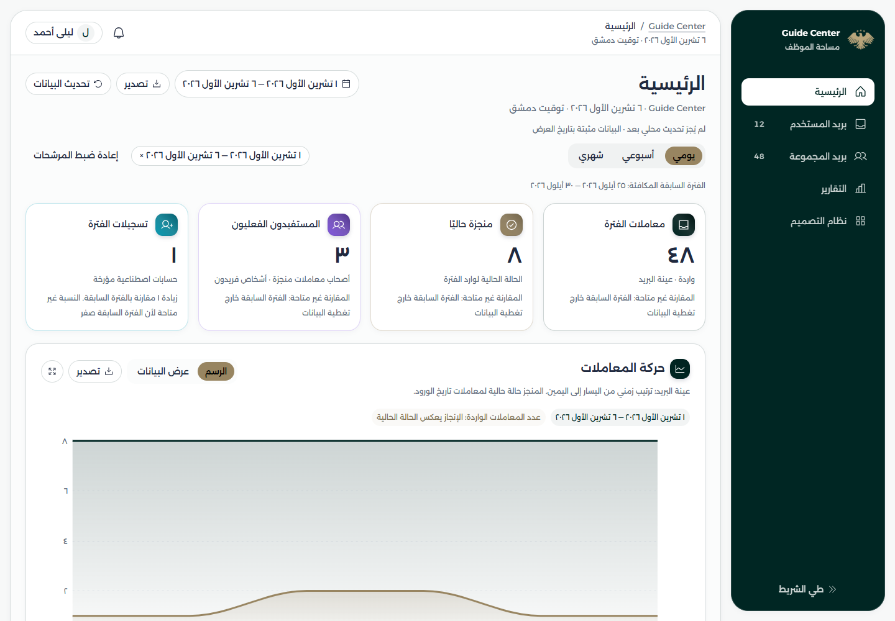
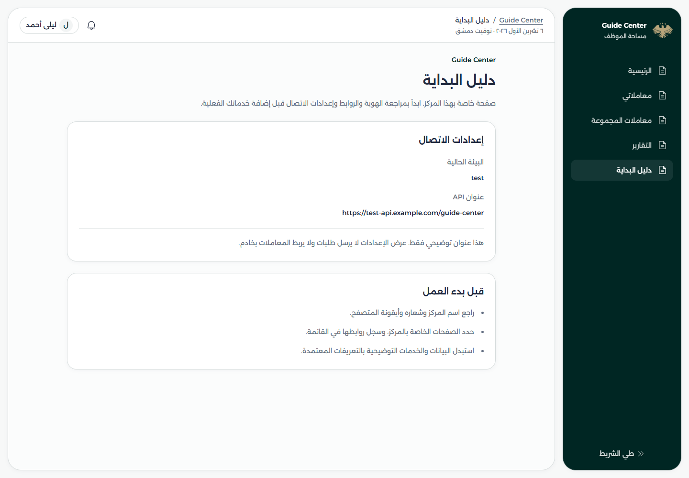
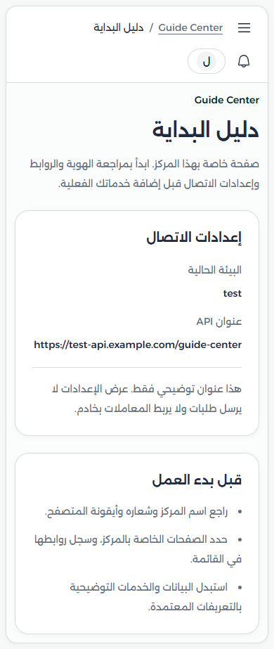
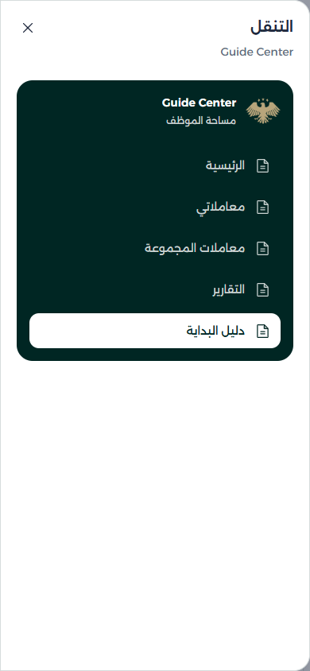
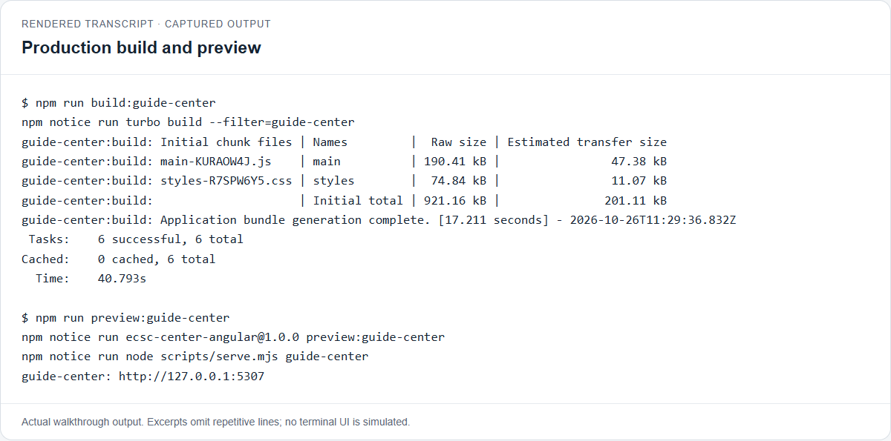
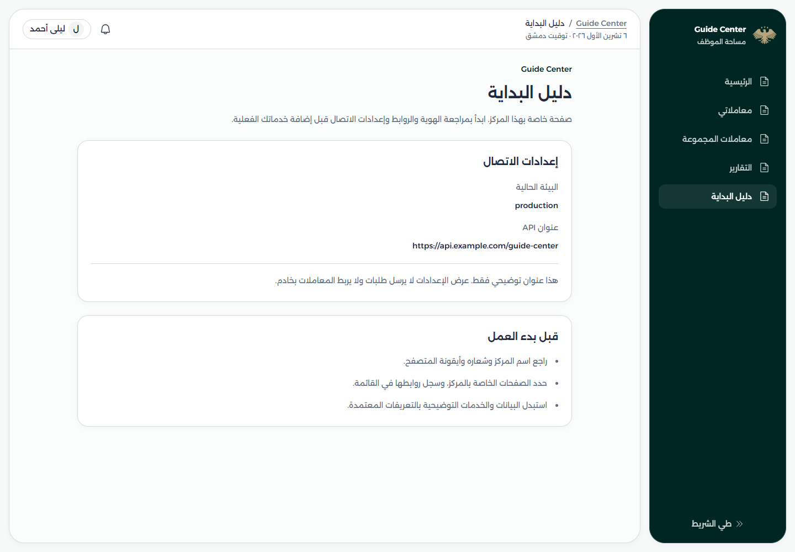

# Create your first center

This walkthrough takes a new application from its first generator prompt to a working production preview. You will give it an identity, add a page owned by that center, connect the page to its menu, and check which API settings reach the browser.

The example ID is **`guide-center`**, with the display name **Guide Center**. Use your own unused ID when doing this for real. Existing centers are independent applications, not a fixed list you must extend by hand.

The screenshots were captured on 26 October 2026 in an isolated temporary worktree. The demonstration application is not registered in the main checkout. Arabic application content is preserved; the tutorial text is English. Terminal and file-list images are explicitly labeled **rendered transcripts** of captured output, with repetitive lines omitted.

## Before you start

- Open a terminal in the repository root: the folder containing `package.json`, `angular.json`, and `scripts/`.
- Use a Node.js version supported by `engines.node` and the npm version in `packageManager`, both in the root [package.json](../../package.json). The captured run used Node.js 24.15.0 and npm 12.0.2.
- Install dependencies with `npm ci`. The isolated walkthrough used `npm ci --ignore-scripts --no-audit --no-fund`; it did not change the main checkout's dependencies.
- Keep a second terminal available for generation and configuration while the development server runs.

On PowerShell, enable the workspace's short `ng` command in each terminal where you need it:

```powershell
.\dev.ps1
```

This enables the project's `ng` command in the current terminal. Run it again in each new PowerShell terminal before using the commands below.

## The short path

```sh
npm run center:new -- guide-center
# Answer n, then enter Guide Center.
npm run dev:guide-center
```

Open the URL printed by the terminal. Later, stop the server with `Ctrl+C` and run:

```sh
npm run build:guide-center
npm run preview:guide-center
```

The sections below cover the configuration between those commands. Full generator options belong in the [generator reference](../center-generator.md).

## 1. Choose the ID and identity

From the repository root:

```sh
npm run center:new -- guide-center
```

In Windows PowerShell, use `npm.cmd` in place of `npm` if npm.ps1 does not forward arguments correctly. The captured run used `npm.cmd`.

The technical ID is already supplied, so the generator asks:

```text
Does this center have a defined visual identity? (y/n): n
Center name: Guide Center
```

The **ID** is used for folders, script names, and route prefixes. Start with a lowercase Latin letter; use lowercase letters, digits, and hyphens. The **display name** appears in the interface and browser title. An existing ID is rejected rather than overwritten.

We executed the default-identity path, answering `n`. This skips the color questions and uses primary `#002623`, secondary `#988561`, and the shared default image for the logo and favicon. The login receives the stars pattern.



_Captured prompt/output excerpts. The normal run also completed its npm workspace-link and lockfile update._

**Alternative, inspected but not used for these screenshots:** answer `y` to enter primary and secondary HEX colors before the display name. Supply an authentic local logo with `--logo`; otherwise the custom-identity path creates a temporary marker. For example:

```sh
npm run center:new -- guide-center --name "Guide Center" --visual-identity y --primary "#397b73" --secondary "#baa97d" --logo ./my-logo.png --dry-run
```

Run that preview **before** creating the center: even a dry run rejects an existing ID. `my-logo.png` represents your own file; it is not bundled with this guide. Do not combine default identity (`n`) with custom color or logo flags.

## 2. Review what was generated

The generator creates the app, registers it in Angular/npm/Turbo, creates a browser smoke-test file, and installs workspace links. You do not need to edit a shared center-name list.



_This filesystem capture includes the page and separate favicon added later in the walkthrough. Those are walkthrough additions, not generator output._

| File or folder under `apps/guide-center`    | What you edit there                                                     |
| ------------------------------------------- | ----------------------------------------------------------------------- |
| `src/config/center.ts`                      | Display name, logo/favicon URLs, and login pattern                      |
| `brand.json` / `src/brand.css`              | Recorded identity inputs / applied theme values                         |
| `public/brands/guide-center/`               | The app's copied logo, favicon, and pattern images                      |
| `src/config/module.ts`                      | Composition: profile, catalog, adapter, routes, navigation, and reports |
| `src/config/services.ts` / `reports.ts`     | Illustrative catalog, demo settings, and report definitions             |
| `src/routes.ts` / `navigation.ts`           | Page destinations / menu presentation                                   |
| `src/environments/` / `src/app.config.ts`   | Build-time settings / their API provider wiring                         |
| `src/pages/`                                | Center-owned pages you add; this folder is not initially generated      |
| `src/main.ts` / `styles.css` / `index.html` | Bootstrap, shared styles plus brand styles, and browser document        |

At the root, check the new project in `angular.json`, `dev:guide-center`, `build:guide-center`, and `preview:guide-center` in `package.json`, the app build task in `turbo.json`, and the updated `package-lock.json`. The generated smoke test lives at `tests/e2e/guide-center.generated.spec.ts`; it belongs to Playwright, not the unit test suite.

Generated catalogs, decisions, fees, accounts, and records are illustrative. Review them before building real features. Shared source code does **not** mean independently running applications share an in-memory store.

## 3. Check the logo and favicon paths

For this default-identity run, the generator copied:

```text
assets/branding/default-center/id.webp
  -> apps/guide-center/public/brands/guide-center/logo.webp
```

The generated Angular asset mapping serves this at:

```text
/assets/brands/guide-center/logo.webp
```

Keep filesystem paths and browser URLs separate. The repository's root `assets/` folder is tooling input, not a global public folder served by every app.

We also exercised a separate favicon file, retaining the same default artwork. From PowerShell:

```powershell
Copy-Item assets/branding/default-center/id.webp apps/guide-center/public/brands/guide-center/favicon.webp
```

On a POSIX shell, use `cp` for the same copy. Set the profile's `favicon` in `src/config/center.ts` to `/assets/brands/guide-center/favicon.webp`, then use that URL for `<link rel="icon">` in `src/index.html` too. Bootstrap updates the favicon from the profile, so keep both declarations aligned.

For an actual replacement logo, copy your approved image into the same app-owned brand folder and update `logo` and `source` in the profile. Update `favicon` and the document link if its filename changes. No custom artwork was supplied in this walkthrough. The [shared-assets guide](../../assets/README.md) explains source assets and copied files.

`brand.json` records the selected colors; `brand.css` supplies the applied tokens. Editing the JSON alone does not regenerate CSS. See [branding details](../center-generator.md#branding-and-sample-data) before changing theme values.

## 4. Start the app and enter its workspace

```sh
npm run dev:guide-center
```

Keep this terminal running and open its printed URL. In this run it was `http://localhost:5207`, leading to `/login`. The generator chooses an unused **configured** port; your number may differ, and it does not check whether an unrelated program already occupies it.


_Real development capture at 1440 × 1000. Blank demo login is accepted; this is not production authentication._

Click the Arabic **Sign in** button with the fields empty to open `/centers/guide-center`.



_The shared dashboard runs with this application's identity and illustrative data. It does not establish approved business rules for a new center._

## 5. Add a center-owned page

In a second PowerShell terminal at the repository root:

```powershell
.\dev.ps1
ng g page --center-name=guide-center getting-started
```

It creates a folder with separate `getting-started.ts` and `getting-started.html` files under `apps/guide-center/src/pages/getting-started/`. It skips test and CSS files by default. Add `--style=css` if you need a stylesheet; other flags are in the [development guide](../development-guide.md#3-generate-files).

Replace the generated TypeScript with:

```ts
import { Component, inject } from '@angular/core';
import { API_CONFIG } from '@workspace/data-access';
import { environment } from '../../environments/environment';

@Component({
  imports: [],
  selector: 'app-getting-started',
  templateUrl: './getting-started.html',
})
export class GettingStarted {
  readonly api = inject(API_CONFIG);
  readonly environmentName = environment.name;
}
```

Use the accompanying [HTML example](assets/create-center/getting-started.html.txt) for the template. It contains the localized text shown in the screenshots, two small information panels, and the bound environment/API values. From PowerShell you can copy it directly:

```powershell
Copy-Item docs/guides/assets/create-center/getting-started.html.txt apps/guide-center/src/pages/getting-started/getting-started.html
```

This page belongs to one center, so it stays in that app. It reads the shared `API_CONFIG` through a public package import, without changing shared libraries. Importing this app's own environment is appropriate here; a shared service must not import an application's environment.

## 6. Register the URL and the menu link

Generating a page does not register it. In `apps/guide-center/src/routes.ts`, retain `pages` and add the component to `extensions`:

```ts
import type { CenterPages, CenterRoute } from '@workspace/core';
import { GettingStarted } from './pages/getting-started/getting-started';

export const extensions: CenterRoute[] = [{ path: 'getting-started', component: GettingStarted }];
export const pages: CenterPages = {};
```

Its URL is `/centers/guide-center/getting-started`. The path in the registration is relative, without a leading slash or center prefix.

For the captured example, replace `navigation.ts` with the accompanying [navigation example](assets/create-center/navigation.ts.txt). It keeps links for home, the two inboxes, and reports, and adds the localized **Getting started** link with `path: 'getting-started'`. On PowerShell:

```powershell
Copy-Item docs/guides/assets/create-center/navigation.ts.txt apps/guide-center/src/navigation.ts
```

The generated `config/module.ts` already imports and passes `extensions`, `pages`, and `navigation` to `defineCenter`; no extra bootstrap registration is needed.

**Routes open pages; navigation displays links.** An explicit navigation array defines the whole menu, so other default links are not appended automatically. Alternatively, keep `navigation` undefined and give the extension route a `label` to add it to the default menu. That alternative was inspected, not used for these captures. Hiding a link does not remove its route or restrict access.

The current extension contract accepts `path`, `component`, `label`, and `icon`; it is not a full Angular `Routes` passthrough. See [routing limits](../ARCHITECTURE.md#routing-and-its-current-limits) and [navigation](../center-navigation.md) for advanced decisions.

## 7. Set the API addresses and verify the page

The generator starts both API addresses at `/api`. For a visible build-time check, we changed only `apiBaseUrl` in these files:

| File under `apps/guide-center/src/environments` | `name`       | `production` | `apiBaseUrl` used in the capture            |
| ----------------------------------------------- | ------------ | ------------ | ------------------------------------------- |
| `environment.ts`                                | `test`       | `false`      | `https://test-api.example.com/guide-center` |
| `environment.production.ts`                     | `production` | `true`       | `https://api.example.com/guide-center`      |

These are illustrative addresses, not working backend endpoints. The example page **displays** them and sends no HTTP request. Replace them with your actual addresses when implementing an integration.

`app.config.ts` already provides `provideApiConfig({ baseUrl: environment.apiBaseUrl })`, and `main.ts` passes that configuration into the shared bootstrap. Always import the base `environment.ts`; the production build's `fileReplacements` in `angular.json` selects the production file. Rebuild after changes: these are build-time values, not a runtime configuration service.

Open the new menu link after the dev server finishes rebuilding:



_The selected menu link opens the app-owned page. It shows the injected API address and `test` environment from the running development build._

Environment values are public browser-bundle content. Keep secrets out. A base URL alone does not connect the existing transaction features to a backend, translate different response shapes, configure a proxy, or add authentication. The generated memory adapter is still in use. Follow the [API guide](../api-configuration.md) when implementing requests or replacing an adapter.

## 8. Check a useful mobile viewport

At 390px wide, confirm the page reflows and the menu opens as a mobile sheet. Select its new link and check that the sheet closes and the page remains reachable.



_Full-page mobile capture at a 390 × 844 viewport. The API address wraps inside its panel._



_The actual mobile menu, opened before selecting the page again. Desktop and mobile use the same navigation definition._

## 9. Build and preview production

From the root:

```sh
npm run build:guide-center
npm run preview:guide-center
```

The build includes this app and its library dependencies, without building unrelated centers. Using shared components or services from `packages` is expected; their required code is bundled into the application. The output is `dist/apps/guide-center/browser/`.



_Actual output excerpts. Absolute local output paths and unrelated build lines are omitted. The preview in this run was `http://127.0.0.1:5307`._

Open the printed **preview** URL, rather than the still-running development URL, and select the same page:



_The same page now shows `production` and the production address. Direct reload of this page also succeeded in the local preview._

Preview serves existing build files; it does not rebuild after edits. Stop/restart processes with `Ctrl+C` as needed. No deployment is performed by these commands.

## If something does not work

| Symptom                                    | What to check                                                                                                                               |
| ------------------------------------------ | ------------------------------------------------------------------------------------------------------------------------------------------- |
| Unknown `page` or center argument          | Run `.\dev.ps1` in that terminal, then retry the `ng` command.                                                                              |
| Generator refuses the ID                   | Check `angular.json` and `apps/`; choose an unused ID instead of overwriting an app.                                                        |
| Files exist but the workspace cannot start | If installation failed or you used `--skip-install`, run `npm install --ignore-scripts` at the root.                                        |
| Address already in use                     | Stop the process occupying the printed port or choose an available dev port in `angular.json`. Check the corresponding preview port too.    |
| Page exists but URL fails                  | Confirm the component is in `extensions` and the URL contains the correct center ID.                                                        |
| Page opens but menu link is missing        | Check `navigation.ts`; custom arrays define the entire menu. A label on a route only extends the default menu when navigation is undefined. |
| Logo or favicon is missing/stale           | Check the `/assets/brands/guide-center/` URL, profile and document references, and the file extension. Browsers may cache favicons.         |
| API calls fail after setting a URL         | Check the real service, endpoint contract, CORS, and any required proxy. The scaffold creates no backend or proxy.                          |
| Preview shows old configuration            | Rebuild, then open the preview port. Editing an environment file does not update an existing production bundle.                             |

## Finish with these checks

- [ ] The technical ID and display name are correct, and the center starts from its root script.
- [ ] Logo, favicon, colors, and login pattern use the intended app-owned assets.
- [ ] The local page opens through its menu link and by direct URL.
- [ ] The mobile menu works and the document has no sideways overflow.
- [ ] Test and production values are correct and contain no secrets.
- [ ] Illustrative catalogs/data are identified, and real integration work has a defined owner.
- [ ] The filtered production build succeeds and its preview shows the production settings.

**What was verified for this guide:** real generation with default identity and npm update; separate favicon setup; dev startup and blank demo login; generated page and menu navigation; 1440px desktop and 390px mobile captures; no mobile document overflow; app typecheck, ESLint, and import boundaries; a successful production build; preview navigation, direct reload, and environment replacement. Browser assertions reported no uncaught page errors. The demonstration stayed outside the main application tree, and its servers were stopped after capture.

Custom identity/logo input was inspected in the implementation/help but not exercised. No real API, production authentication, deployment, full browser matrix, or generated Playwright smoke suite was tested. The existing default-logo aspect-ratio and initial chart-sizing console warnings were observed during development; they did not block the walkthrough and were not changed by this documentation task.
